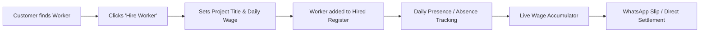

The **GaonKaam** platform implements a two-tier work and attendance management architecture designed specifically for rural ecosystems:

1. **The MGNREGA (मनरेगा) Government Work & Digital Muster Roll Portal** — for panchayat public schemes, job-card holders, and official daily muster roll verification.
2. **The Private Hire & Work Owner Attendance Register** — for village residents and contractors who hire local carpenters, masons, farm laborers, and electricians to mark daily presence/absence and calculate accumulated wages.

---

### Part 1: MGNREGA (मनरेगा) Government Work & Digital Attendance Portal

#### 1. Purpose & Access
- Accessible via the **🏛️ MGNREGA Govt Work** navigation tab or screen (`#screenMnrega`).
- Automatically filters projects and job-card workers by the user's active village (e.g., *Sundarpur*) and block.
- Follows the Ministry of Rural Development's **National Mobile Monitoring System (NMMS)** guidelines for transparent rural wage tracking.

#### 2. Key Data Model (`data.js` → `GAON_DATA.mnregaProjects`)
Each project record tracks the village scheme details:
```javascript
{
  id: "MNR-SUNDAR-01",
  village: "Sundarpur",
  block: "Robertsganj",
  title: "Amrit Sarovar Pond De-Silting & Beautification",
  titleHi: "अमृत सरोवर तालाब गहरीकरण एवं सुंदरीकरण",
  projectCode: "UP-SON-2026-0891",
  sanctionedWage: 260, // ₹ / day official government fixed wage
  totalDays: 60,
  daysCompleted: 24,
  totalBudget: 468000,
  workersNeeded: 20,
  status: "active",
  gramRozgarSevak: "Dinesh Kumar (Rozgar Sevak)",
  contactPhone: "+91 94567 11223",
  workSiteLandmark: "Sundarpur Purana Pokhra (East Field)"
}
```

#### 3. Real-Time Muster Roll Attendance Dashboard (`app.js` → [`renderAttendanceViewHTML`](file:///C:/Users/manje/.gemini/antigravity/scratch/gaonkaam-web/app.js))
When opened, the portal calculates four live metrics:
* **Total Registered Workers**: Counts all job-card laborers enrolled in the village.
* **Present Today (`presentCount`)**: Workers on site for today's shift.
* **Absent Today (`absentCount`)**: Workers not reporting to the work site.
* **Daily Wages Payable**: Computed automatically as `Present Workers × ₹260 (Govt Sanctioned Wage)`.

#### 4. Individual Worker Attendance Verification (`GAON_DATA.mnregaWorkers`)
Each registered job-card laborer displays:
- **Worker Name & Gender** (e.g., *Ramlal Kol*, *Phoolmati Devi*).
- **Official MGNREGA Job Card Number** (e.g., `UP-05-231-014/001`).
- **Aadhaar-Linked & DBT Active Badges** ensuring direct bank transfer compliance.
- **Attendance Toggle Button**:
  - Clicking **`[✓ उपस्थित / Present]`** (Green) or **`[✕ अनुपस्थित / Absent]`** (Red) instantly toggles their status.
  - Updates the total wage pool in real time without refreshing the page.
- **Quick Action Controls**:
  - `Mark All Present`: Marks the full muster roll present in one click.
  - `Reset Attendance`: Clears the muster roll for re-entry.
  - `Submit Digital Muster Roll`: Simulates the NMMS upload to the district server.

---

### Part 2: Private Work Owner & Hired Worker Attendance Register

This feature addresses the workflow where an individual customer hires a skilled worker and manages their day-to-day employment.



#### 1. Adding a Worker Upon Hiring (`app.js` → [`handleConfirmHireSubmit`](file:///C:/Users/manje/.gemini/antigravity/scratch/gaonkaam-web/app.js))
When a customer clicks **Hire Worker** on any profile:
- A modal captures:
  - Worker's Name, Trade, and Phone number.
  - Project Title (e.g., *"Boundary Wall & Verandah Construction"* or *"Paddy Sowing"*).
  - Agreed Daily Wage (e.g., `₹600/day`).
  - Work Site Landmark in the village.
- The worker is immediately added to the employer's **Hired Workers List** (`AppState.hiredWorkers`), persisted in `localStorage`.

#### 2. The Interactive Day-Pill Attendance Matrix (`renderHiredWorkersAttendanceSection`)
Under the employer's dashboard, each hired worker has an attendance timeline:
- **Calendar Day Pills**: Each day of the contract is represented by an interactive pill button (e.g., `Sun 25 Oct`, `Mon 26 Oct`, `Tue 27 Oct`...):
  - **`[P]` (Present - Green)**: Marks that the worker reported to work.
  - **`[A]` (Absent - Red)**: Marks that the worker did not report.
- **One-Click Toggle (`toggleHiredWorkerDayAttendance`)**:
  - Clicking any date pill flips it between `P` and `A`.
  - The system recalculates the worker's earnings on the fly.
- **Timeline Expansion (`addAttendanceDay`)**:
  - Allows the work owner to append new days to the timeline if the project extends.

#### 3. Dynamic Wage Accumulator & KPI Dashboard
For each worker, the system computes:
$$\text{Total Wages Due} = \text{Total Days Present } [P] \times \text{Agreed Daily Wage}$$
* **Cumulative Metrics Bar**:
  - Total days present across all hired workers.
  - Total days absent.
  - Cumulative wages earned vs. balance payable.

#### 4. WhatsApp Attendance Slip Generator (`sendWhatsAppAttendanceSlip`)
- Work owners can click **"WhatsApp Slip"** next to any worker.
- Generates a pre-formatted message listing:
  - *Employer Name & Village*
  - *Worker Name & Trade*
  - *Dates Present & Dates Absent*
  - *Total Days Worked × Daily Rate = Total Amount Due*
- Launches WhatsApp directly to share the slip with the worker, preventing payment disputes.

---

### Part 3: Worker's Side View (Worker Dashboard)

When a worker logs in or switches their role to **Worker**:
- They see a **"My Work & Attendance"** section:
  - Displays the project they are actively hired for.
  - Shows which days their employer marked them as **Present `[P]`** or **Absent `[A]`**.
  - Displays their total accumulated earnings to date, ensuring transparency.

---

### Part 4: Code Architecture Map

| Feature Component | Relevant Files & Lines | Key Functions / Elements |
| :--- | :--- | :--- |
| **MGNREGA Data Models** | [`data.js`](file:///C:/Users/manje/.gemini/antigravity/scratch/gaonkaam-web/data.js) | `mnregaProjects`, `mnregaWorkers` |
| **MGNREGA Portal UI & Logic** | [`app.js`](file:///C:/Users/manje/.gemini/antigravity/scratch/gaonkaam-web/app.js) | [`renderMnregaPortal`](file:///C:/Users/manje/.gemini/antigravity/scratch/gaonkaam-web/app.js), [`renderAttendanceViewHTML`](file:///C:/Users/manje/.gemini/antigravity/scratch/gaonkaam-web/app.js), `markAllMnregaPresent` |
| **MGNREGA Screen Shell** | [`index.html`](file:///C:/Users/manje/.gemini/antigravity/scratch/gaonkaam-web/index.html) | `<div id="screenMnrega">`, `<div id="mnregaScreenContent">` |
| **Hired Workers Attendance Logic** | [`app.js`](file:///C:/Users/manje/.gemini/antigravity/scratch/gaonkaam-web/app.js) | [`renderHiredWorkersAttendanceSection`](file:///C:/Users/manje/.gemini/antigravity/scratch/gaonkaam-web/app.js), [`toggleHiredWorkerDayAttendance`](file:///C:/Users/manje/.gemini/antigravity/scratch/gaonkaam-web/app.js), [`sendWhatsAppAttendanceSlip`](file:///C:/Users/manje/.gemini/antigravity/scratch/gaonkaam-web/app.js) |
| **Hired Team Banner & Modal** | [`index.html`](file:///C:/Users/manje/.gemini/antigravity/scratch/gaonkaam-web/index.html) | `<div id="hireScreenHiredBanner">`, `<div id="modalHireConfirm">` |
| **Attendance Styles & Day Pills** | [`styles.css`](file:///C:/Users/manje/.gemini/antigravity/scratch/gaonkaam-web/styles.css) | `.attendance-kpi-grid`, `.att-card`, `.calendar-day-pill`, `.status-p`, `.status-a` |